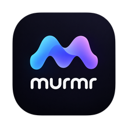
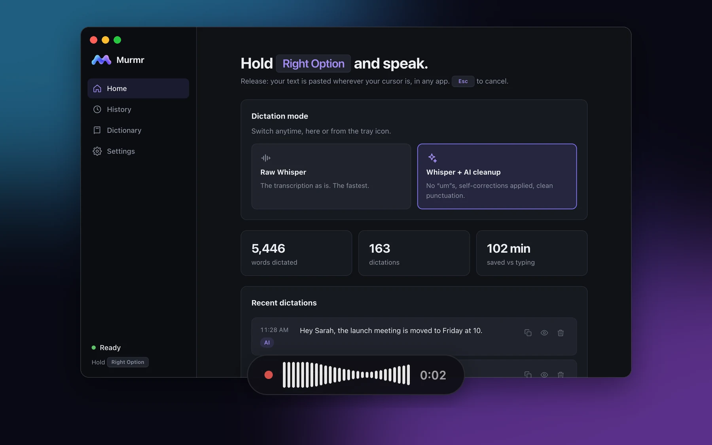
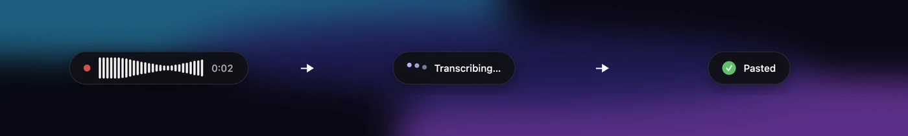
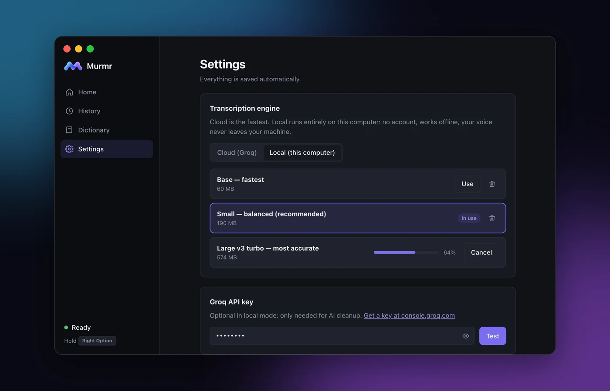
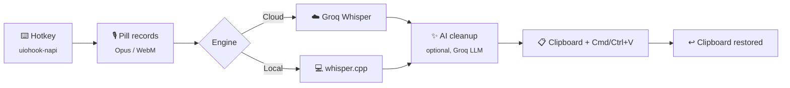

<div align="center">



# Murmr

### Speak. It types.

**Free, open-source voice dictation for macOS, Windows and Linux.**<br />
Hold a key, talk, and clean text lands wherever your cursor is: in any app.

[](LICENSE)
[](#-quick-start)
[](#-why-murmr)
[](#%EF%B8%8F-cloud-or-local-your-call)
[](https://www.electronjs.org)
[](https://github.com/lucas-burlot/Murmr/stargazers)

[**Features**](#-features) · [**Quick start**](#-quick-start) · [**How it works**](#-how-it-works) · [**FAQ**](#-faq) · [**Roadmap**](#%EF%B8%8F-roadmap)

<br />



</div>

<br />

> **Typing is slow. Talking isn't.** Most people speak at ~150 words per minute and type at ~40.
> Murmr turns your voice into polished text in any app, with the "um"s removed and your mistakes fixed, without a subscription.

## 💜 Why Murmr

Voice dictation apps like Wispr Flow are great, but they cost a monthly subscription and send every word you say to their servers. Murmr does the same job **for free**, it's **open source**, and it can run **100% on your own computer**.

|  | **Murmr** | Wispr Flow |
| :--- | :---: | :---: |
| **Price** | **Free, forever** | ~$15 / month¹ |
| **Open source** | ✅ MIT | ❌ |
| **Works offline** | ✅ local engine | ❌ |
| **Your voice stays on your machine** | ✅ local engine | ❌ |
| **AI cleanup** (fillers, self-corrections, punctuation) | ✅ | ✅ |
| **Personal dictionary** | ✅ | ✅ |
| **Bring your own provider** (any OpenAI-compatible API) | ✅ | ❌ |
| **Platforms** | macOS · Windows · Linux | macOS · Windows · iOS |

<sub>¹ Wispr Flow Pro, billed monthly; its free tier is capped at ~2,000 words per week. Pricing according to third-party guides, October 2026.</sub>

## ✨ Features

<table>
<tr>
<td width="50%" valign="top">

### 🎙️ Push-to-talk, anywhere
Hold **Right Option** (macOS) or **Right Ctrl** (Windows/Linux), speak, release. Your text is pasted in Slack, Gmail, Notion, VS Code, your terminal… Any shortcut works, plus a hands-free *press to start / press to stop* mode.

</td>
<td width="50%" valign="top">

### ✨ AI cleanup that gets you
*"Let's meet Thursday, no actually Friday at 10"* becomes *"Let's meet Friday at 10."* Fillers, stutters and false starts disappear, punctuation is fixed, and spoken lists turn into real lists.

</td>
</tr>
<tr>
<td valign="top">

### ☁️ Cloud **or** 💻 local
Use Groq's free Whisper API (sub-second), or run Whisper **entirely on your machine** with whisper.cpp: no account, no internet, nothing leaves your computer.

</td>
<td valign="top">

### 📖 Personal dictionary
Names, brands, jargon: add them once and Murmr spells them right every time, in both transcription and cleanup.

</td>
</tr>
<tr>
<td valign="top">

### 🕘 Searchable history
Every dictation is saved locally, with the original transcript next to the cleaned version. Copy it again in one click.

</td>
<td valign="top">

### 🌍 Speaks your language
Dictate in 99 languages with auto-detection. The interface is available in **English** and **French**.

</td>
</tr>
<tr>
<td valign="top">

### 🫧 A pill that stays out of your way
A tiny floating pill shows a live waveform while you talk, then disappears. It never steals focus from the app you're typing in.

</td>
<td valign="top">

### 📋 Clipboard-friendly
Murmr pastes through the clipboard, then puts back what you had copied before, images and rich text included.

</td>
</tr>
</table>

<div align="center">
<br />

<sub><b>Listening → Transcribing → Pasted.</b> Often in under a second.</sub>
</div>

## ☁️ Cloud or local: your call



|  | ☁️ **Cloud** (default) | 💻 **Local** |
| :--- | :--- | :--- |
| **Engine** | Whisper large-v3 on [Groq](https://groq.com) | Whisper via [whisper.cpp](https://github.com/ggml-org/whisper.cpp) (Metal on Apple Silicon) |
| **Speed** | ⚡ typically under a second | ⚡ fast on Apple Silicon (~0.1 s for a sentence with Base) |
| **Needs** | A free Groq API key (no credit card) | A one-time model download |
| **Limits** | ~8 h of audio per day (free tier) | None |
| **Privacy** | Audio sent to Groq | 🔒 Never leaves your computer |

Local models come from the official whisper.cpp repository and are **verified by SHA-256** after download:

| Model | Size | Best for |
| :--- | :---: | :--- |
| **Base** | 60 MB | older machines, maximum speed |
| **Small** ⭐ | 190 MB | the sweet spot (recommended) |
| **Large v3 turbo** | 574 MB | best accuracy |

> 💡 The optional AI cleanup always uses Groq. Without a key, local mode simply pastes the raw transcript, so Murmr works with **zero accounts**.

## 🚀 Quick start

> **Prebuilt installers are coming soon** to [Releases](https://github.com/lucas-burlot/Murmr/releases). Until then, it takes 3 commands:

```bash
git clone https://github.com/lucas-burlot/Murmr.git
cd Murmr
npm install && npm start
```

Requires [Node.js](https://nodejs.org) 22+. On first launch, a short checklist walks you through setup:

1. **Pick your engine**: paste a free key from [console.groq.com/keys](https://console.groq.com/keys), *or* switch to **Local** and download a model.
2. **Allow the microphone.**
3. **macOS only: allow Accessibility** in *System Settings → Privacy & Security → Accessibility*, so Murmr can detect your hotkey and paste. With `npm start`, enable the **terminal app** you launched it from.

Then hold **Right Option** / **Right Ctrl** and start talking. 🎉

<details>
<summary><b>📦 Build the installers yourself</b></summary>

<br />

```bash
npm run dist:mac     # → dist/Murmr-<version>-arm64.dmg
npm run dist:win     # → NSIS .exe installer
npm run dist:linux   # → .AppImage and .deb
```

Build each installer on its own OS (or in CI). Builds are currently unsigned: on first launch, macOS needs *right-click → Open* and Windows shows SmartScreen.

</details>

## ⌨️ Usage

| Action | What happens |
| :--- | :--- |
| **Hold** the hotkey | The pill appears and Murmr listens |
| **Release** | Your words are transcribed, cleaned and pasted at the cursor |
| **Esc** while recording | Cancels: nothing is sent, nothing is pasted |
| Another key while holding | Cancels too, so shortcuts like <kbd>Option</kbd>+<kbd>E</kbd> keep working |
| Tray icon → **Cloud / Local** | Switch the transcription engine |
| Tray icon → **AI cleanup** | Toggle between the raw transcript and AI-cleaned text |

Change the hotkey in *Settings → Shortcut*: click **Change** and press any modifier or F-key.

## 🧠 How it works



Murmr is built with **Electron**, **React** and **TypeScript**. The interesting parts:

| File | Role |
| :--- | :--- |
| [`src/main/dictation.ts`](src/main/dictation.ts) | The pipeline: recording → transcription → cleanup → paste |
| [`src/main/groq.ts`](src/main/groq.ts) | OpenAI-compatible client (Whisper + chat), retries, error codes |
| [`src/main/local-whisper.ts`](src/main/local-whisper.ts) | On-device transcription with whisper.cpp |
| [`src/main/models.ts`](src/main/models.ts) | Model downloads with progress, SHA-256 check and cancel |
| [`src/main/text.ts`](src/main/text.ts) | Cleanup prompt and Whisper hallucination filter |
| [`src/main/hotkey.ts`](src/main/hotkey.ts) | Hold / toggle / cancel state machine |
| [`src/renderer/overlay/`](src/renderer/overlay) | The floating pill: mic capture and live waveform |
| [`src/shared/i18n.ts`](src/shared/i18n.ts) | Translations (adding a language takes one dictionary) |

## 🔒 Privacy

- **No Murmr server.** Ever. There is nothing to sign up for.
- **Local mode** keeps your audio on your computer, end to end.
- **Cloud mode** sends audio only to the provider *you* configure (Groq by default).
- Your API key is encrypted with your OS keychain. History stays in a local file you can wipe anytime.

## 🗺️ Roadmap

- [x] Push-to-talk dictation in any app
- [x] AI cleanup (fillers, self-corrections, punctuation, lists)
- [x] Cloud (Groq) and local (whisper.cpp) engines
- [x] Personal dictionary and searchable history
- [x] English and French interface
- [ ] Prebuilt, signed installers with auto-update
- [ ] **Command mode**: select text, say *"make it shorter"*, done
- [ ] App-aware styles (casual in Slack, formal in email)
- [ ] Voice snippets (*"my address"* → your full address)
- [ ] Local AI cleanup (no key at all)
- [ ] More interface languages

Ideas welcome: [open an issue](https://github.com/lucas-burlot/Murmr/issues).

## ❓ FAQ

<details>
<summary><b>Is it really free?</b></summary>
<br />
Yes. Murmr is MIT-licensed. Local mode costs nothing at all. Cloud mode uses Groq's free tier: about 8 hours of transcription per day, no credit card.
</details>

<details>
<summary><b>Does it work offline?</b></summary>
<br />
Yes, in local mode. Download a model once in Settings and Murmr transcribes without any internet connection.
</details>

<details>
<summary><b>Why doesn't it use the Fn key like Wispr Flow?</b></summary>
<br />
Fn is handled by the keyboard firmware and isn't reliably visible to cross-platform apps. Murmr defaults to Right Option / Right Ctrl, keys that are almost never used on their own, and you can pick any modifier or F-key.
</details>

<details>
<summary><b>Why does macOS ask for Accessibility access?</b></summary>
<br />
To detect your hotkey from any app and to paste the text where your cursor is. Murmr only reacts to your hotkey: it never logs what you type and doesn't read your screen. You can check exactly what it does in <a href="src/main/main.ts"><code>src/main/main.ts</code></a>.
</details>

<details>
<summary><b>Does it work on Linux?</b></summary>
<br />
Yes on X11. On pure Wayland, compositors block global hotkeys for all apps, so use an X11 session. Also note that most Linux terminals paste with Ctrl+Shift+V.
</details>

<details>
<summary><b>Can I use OpenAI, a local server or another provider?</b></summary>
<br />
Yes. Any OpenAI-compatible API works: change the API URL in Settings → Advanced.
</details>

## 🛠️ Development

```bash
npm install
npm start           # build and run
npm test            # unit tests (Vitest)
npm run typecheck   # TypeScript, main + renderer
```

Contributions are very welcome! Fork, create a branch, make sure `npm test` and `npm run typecheck` pass, and open a pull request.

## 🙏 Acknowledgements

Murmr stands on the shoulders of giants: [OpenAI Whisper](https://github.com/openai/whisper), [whisper.cpp](https://github.com/ggml-org/whisper.cpp), [whisper.node](https://github.com/mybigday/whisper.node), [Groq](https://groq.com), [uiohook-napi](https://github.com/SnosMe/uiohook-napi) and [Electron](https://www.electronjs.org).
Inspired by [Wispr Flow](https://wisprflow.ai) and [FreeFlow](https://github.com/zachlatta/freeflow).

<div align="center">

<br />

**If Murmr saves you some typing, a ⭐ helps others find it.**

<sub>MIT License · Made by <a href="https://github.com/lucas-burlot">Lucas Burlot</a></sub>

</div>
